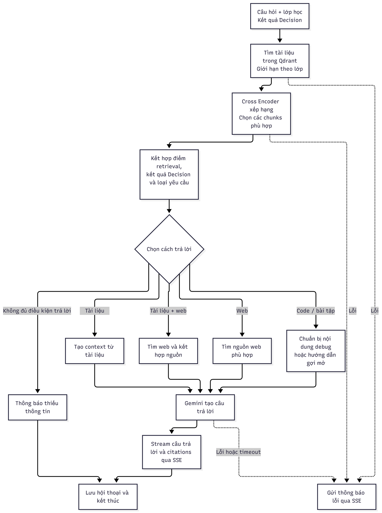

# Course Q&A and Syllabus Agent

An AI-powered course assistant for students and teachers. It answers questions grounded in course materials with citations, manages classes and documents, and supports quiz authoring with Excel import/export.

> Team internship project (AI Engineering). Source code is currently private; contact me for access.

## Repositories

| Part | Stack | Repository |
|---|---|---|
| Backend | FastAPI, PostgreSQL, Qdrant, SQLAlchemy, Alembic | [course-qa-agent-be](https://github.com/208dongpha/course-qa-agent-be) (private) |
| Frontend | Next.js 16, React 19, TypeScript, Tailwind CSS | [course-qa-agent-fe](https://github.com/208dongpha/course-qa-agent-fe) (private) |

## Features

- **RAG question answering** over course documents with source citations and follow-up suggestions.
- **Document ingestion pipeline**: multi-format extraction, chunking, embeddings and vector search in Qdrant.
- **Class and course management**: enrollment, co-teachers, prerequisites, syllabus and roadmap.
- **Quiz workflow**: question generation, teacher review, Excel template export/import with row-level validation.
- **Chat history**: search, rename, reopen and delete conversations.
- **Role-based access control** for admin, trainer and student.
- **Operations**: health checks, API key pool with rotation and an admin dashboard.

## Architecture

```text
Next.js frontend
       |
       v
FastAPI backend  --->  PostgreSQL (transactional data)
       |          --->  Qdrant (vector index)
       |          --->  Gemini / OpenAI (LLM + embeddings)
```

### RAG query pipeline

<p align="center">
  
</p>

<details>
<summary><strong>Retrieval decision flow</strong> (click to expand)</summary>

<p align="center">
  
</p>

</details>

## Tech stack

| Layer | Technologies |
|---|---|
| Backend | Python 3.11+, FastAPI, SQLAlchemy, Alembic, Pydantic, pytest, ruff |
| Frontend | Next.js 16 (App Router), React 19, TypeScript, Tailwind CSS v4, shadcn/ui, Vitest |
| Data | PostgreSQL, Qdrant |
| AI | Google Gemini, OpenAI, RAG (chunking, embeddings, retrieval) |
| DevOps | Docker, Docker Compose, CI pipeline |

## My contributions

- **AI-152 - Quiz import from teacher Excel**: design specification and implementation of preview/import/template endpoints, row/column validation, non-blocking warnings, upload hardening and 27 backend tests.
- Add more items here.

## Getting started

Each repository has its own README with setup instructions:

- Backend: `course-qa-agent-be/README.md`
- Frontend: `course-qa-agent-fe/README.md`

## Notes

- This is a team project. Commit history and authorship are preserved from the original repositories.
- The repository contains source code only; environment files, credentials and runtime data are not included.