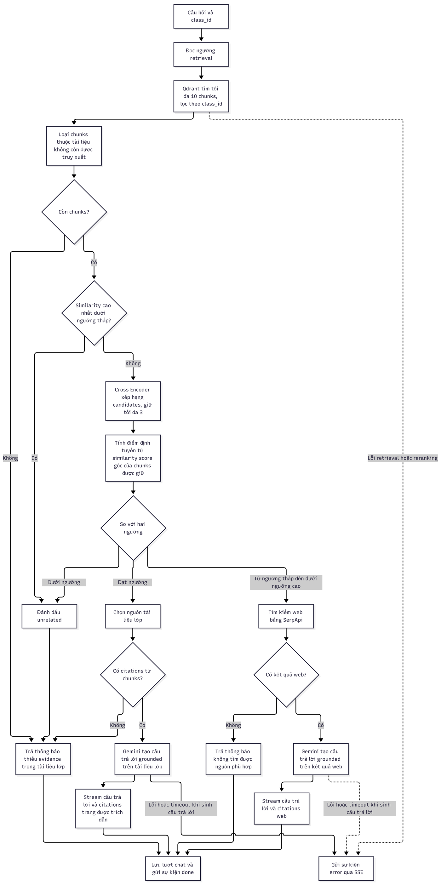

# Course Q&A and Syllabus Agent

A class-scoped AI study assistant for university courses. Students ask questions against the approved materials of their own class and receive streamed answers with source citations; trainers curate materials, syllabus and assessments; administrators manage accounts, classes and platform operations.

**This repository is the project overview and documentation entry point.** It contains this README and architecture diagrams only. The application source lives in the two implementation repositories linked below.

Built as a team AI Engineering internship project. Original source history and authorship remain in the implementation repositories.

## Repositories

| Part | Purpose | Stack | Repository |
|---|---|---|---|
| Overview | Project documentation and architecture diagrams | Markdown | [Course-Q-A-and-Syllabus-Agent](https://github.com/208dongpha/Course-Q-A-and-Syllabus-Agent) |
| Backend | API, RAG pipeline, ingestion, data model and operations | Python 3.12, FastAPI, SQLAlchemy, Alembic, PostgreSQL, Qdrant | [course-qa-agent-be](https://github.com/208dongpha/course-qa-agent-be) |
| Frontend | Role-based web application and chat experience | Next.js 16, React 19, TypeScript, Tailwind CSS v4 | [course-qa-agent-fe](https://github.com/208dongpha/course-qa-agent-fe) |

Access to the implementation repositories follows their GitHub repository permissions. This overview repository does not bundle their source code.

## Product purpose

Answers are **class-scoped and citation-first**:

- Retrieval is filtered to the student's own class, so material from another class is not used as evidence.
- Trainers approve uploaded material before it becomes searchable.
- Chat answers stream from the backend and link back to the cited source.
- Students can escalate an unsatisfactory answer into a ticket for the class trainer.
- Trainers can import, review, approve and export quizzes without leaving the teacher workspace.

## Roles

| Role | Main responsibilities |
|---|---|
| Student | Join classes, read class materials and syllabus, ask cited questions, keep chat history and track tickets. |
| Trainer | Manage class materials, syllabus, members, tickets, content gaps and quizzes. |
| Teaching assistant | Teacher-facing access where supported; can review enrollment requests for a class they belong to. Trainer-only management actions remain restricted. |
| Admin | Manage accounts, classes, bulk imports, email delivery, model/retrieval settings and system health. |

The frontend hides routes by role as a UX convenience; the backend enforces authentication, RBAC and class membership.

## Project-wide capabilities

- **Class-scoped RAG chat** — streaming answers, progress states, citations, source excerpts, suggested follow-ups, feedback and a daily student quota.
- **Document ingestion** — PDF, DOCX, PPTX, XLSX, Markdown and plain-text upload; approval, relevance validation, parsing, chunking, embeddings and Qdrant indexing.
- **Classes and enrollment** — class catalog, join requests, members, prerequisites, co-teachers, class information and template configuration.
- **Tickets** — student-initiated questions to the trainer, replies, unread state, resolve/reopen and expiry.
- **Chat history** — reopen, search, rename, pin and delete conversations.
- **Quizzes** — Excel template import/preview, teacher review and editing, approval/reopen and approved-only export. AI question generation and validation are not shipped in the current source `main`.
- **Administration** — account provisioning and Excel import, email outbox, Gemini key pool/model settings, retrieval thresholds and system health.
- **Content gaps** — repeated student questions surfaced to trainers as material-improvement signals.

## Architecture

The frontend calls the FastAPI backend over REST for application data and Server-Sent Events (SSE) for chat streaming. The backend stores relational data in PostgreSQL, stores embeddings and retrieval metadata in Qdrant, calls Google Gemini for generation/embeddings, and can use SerpApi for optional Internet-source answers.

### RAG query pipeline

<p align="center">
  
</p>

<details>
<summary><strong>Retrieval decision flow</strong> (click to expand)</summary>

<p align="center">
  
</p>

</details>

The diagrams retain their original Vietnamese labels and show the class-scoped retrieval, reranking and source-routing flow.

## Tech stack

| Layer | Technologies |
|---|---|
| Backend | Python 3.12, FastAPI, SQLAlchemy 2, Alembic, Pydantic, pytest, Ruff |
| Frontend | Next.js 16 (App Router), React 19, TypeScript, Tailwind CSS v4, shadcn/ui, Vitest |
| Data | PostgreSQL 16, Qdrant |
| AI | Google Gemini, multilingual Cross Encoder reranker, SerpApi (optional Internet source) |
| Runtime | Docker, Docker Compose, JWT authentication |

## Getting started

This overview repository has no runnable application code. Follow the setup instructions in the implementation repositories:

- **[Backend setup](https://github.com/208dongpha/course-qa-agent-be/blob/main/README.md#getting-started)** — environment, PostgreSQL/Qdrant, migrations, API and tests.
- **[Frontend setup](https://github.com/208dongpha/course-qa-agent-fe/blob/main/README.md#getting-started)** — Node/npm, environment, development server and production build.

Start the backend first, then the frontend. Each repository documents its own prerequisites, configuration and Docker workflow.

## Project status

| Area | Status in the current source `main` |
|---|---|
| Class-scoped RAG, citations, ingestion, classes, tickets, history | Implemented |
| Quiz Excel import/review/approve/export | Implemented |
| AI quiz generation and validation (AI-149/AI-150) | Not shipped; the regeneration action reports unavailable until a generator is configured |
| Student quiz delivery and auto-grading | Not exposed in the current source `main` |
| Attendance API/UI | Not present; data model work only on the backend |
| Admin moderation reports | Placeholder; no moderation API yet |
| Live deployment / all-green test run | Not verified by this overview |

For current behavior, check the implementation repositories and their READMEs.

## Repository layout

```text
.
├── README.md
└── docs/
    ├── rag-query-pipeline.png
    └── retrieval-decision-flow.png
```

This overview repository is documentation-only. Runtime files, credentials and environment secrets are not stored here.
