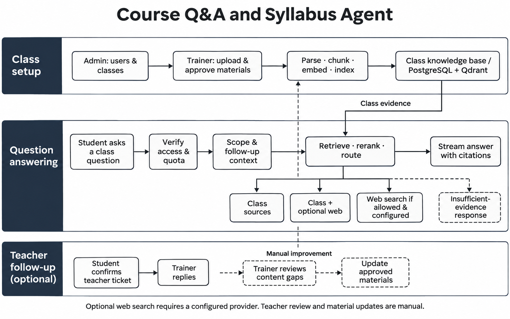
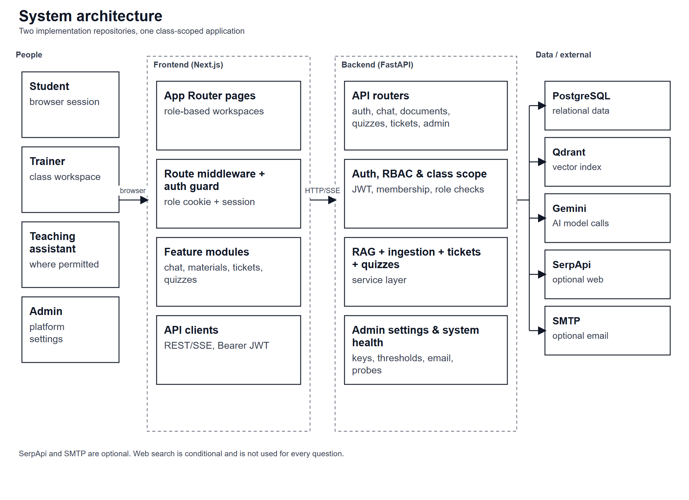
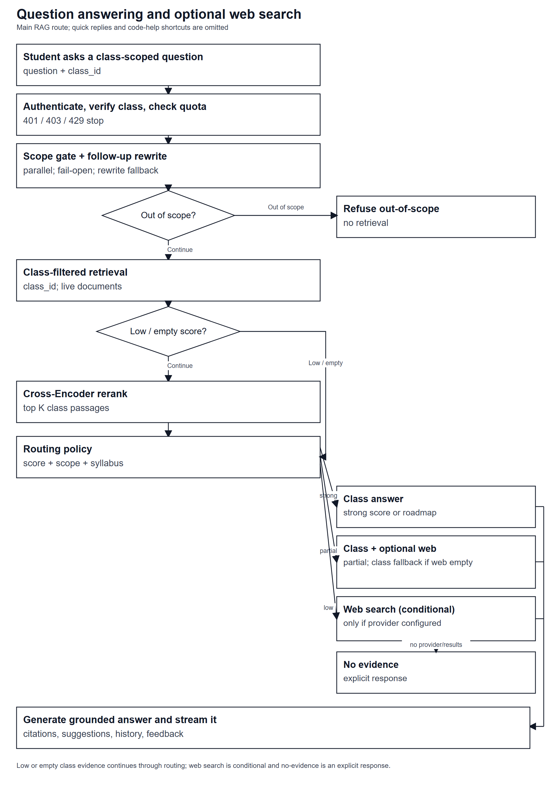

# Course Q&A and Syllabus Agent

A class-scoped AI study assistant for university courses. Students ask questions against the approved materials of their own class and receive streamed answers with citations. Trainers prepare the class knowledge base, answer student tickets and review quizzes. Administrators manage accounts, classes and platform settings.

**This repository is the project overview and documentation entry point.** It contains this README and architecture/workflow diagrams. The application source lives in the two implementation repositories linked below.

Built as a team AI Engineering internship project. Original source history and authorship remain in the implementation repositories.

## Why it exists

Course material is spread across PDFs, slides, spreadsheets and the syllabus. A general chatbot cannot reliably answer from the right class, and a plain document list does not help a student who is stuck at 11 p.m.

This project gives every class its own grounded assistant:

- Retrieval is limited to the student's class, so another class's material is not used as evidence.
- Trainers approve material before it becomes searchable.
- Answers stream with citations back to the source.
- Students can ask their teacher when an answer is not enough.
- Trainers can see recurring questions and improve the material.

## Who uses it

| Role | What they do |
|---|---|
| Student | Join a class, read its syllabus and materials, ask cited questions, keep chat history and track teacher replies. |
| Trainer | Prepare materials and syllabus, review class activity, answer tickets, review quizzes and improve gaps in the material. |
| Teaching assistant | Help with the teacher-facing workspace where supported, including enrollment requests for their class. Trainer-only management actions remain restricted. |
| Admin | Provision accounts and classes, manage bulk imports, email delivery, model/retrieval settings and system health. |

Sign-in is required. Accounts are created by administrators; the product does not offer self-registration.

## End-to-end workflow

1. An admin provisions the accounts, creates the class and assigns its trainer.
2. The trainer uploads class materials and the syllabus, then approves the material for use.
3. The platform parses the files, validates relevance, chunks the text, creates embeddings and indexes the class knowledge base.
4. An authenticated student asks a question in the class chat.
5. The platform checks class access and quota, applies the class-scope gate and resolves follow-up wording.
6. It retrieves and reranks class evidence, then routes the answer:
   - class material when the evidence is strong;
   - class material with optional web sources when the route calls for both;
   - an optional web search when class evidence is not usable and a web provider is configured;
   - an explicit insufficient-evidence response when no usable source exists.
7. The answer streams with citations, suggested follow-ups and progress states. The turn is saved to history and can receive student feedback.
8. If the student confirms that the answer is not enough, they can open a ticket. The trainer replies, and recurring questions become content-gap signals for improving the material.

  

High-level workflow: web search is conditional; trainer review and material updates are manual. Detailed routing is below.

<strong>Technical reference: system architecture</strong>

## Architecture

The frontend is a Next.js App Router application. It calls the FastAPI backend over REST for application data and Server-Sent Events (SSE) for streamed chat. The backend stores relational data in PostgreSQL, stores embeddings and retrieval metadata in Qdrant, and uses Google Gemini for generation and embeddings. SerpApi is optional and only used on web-search routes. SMTP/email delivery is optional and runs through an outbox.

  

<a href="docs/architecture.svg">Open the vector version</a>

<strong>Technical reference: question answering and optional web search</strong>

## Question answering in detail

The chat does more than embed and search. It applies the class boundary, handles follow-ups and quota, reranks candidate passages, and makes an explicit source-routing decision before generation.

The important branches are:

- **Scope:** a confidently out-of-scope question is refused before retrieval.
- **Retrieval:** class-filtered candidates are checked against the lower evidence threshold; weak candidates skip the expensive reranker.
- **Reranking:** a Cross Encoder orders the remaining candidates and keeps the top passages.
- **Routing:** the final route depends on the scope verdict, the evidence score and whether a syllabus roadmap is available.
- **Web search:** when the route permits it and SerpApi is configured, web results are filtered and cited. It is not a default fallback for every question.
- **No evidence:** when no usable source remains, the system returns an explicit insufficient-evidence message instead of inventing an answer.

  

<a href="docs/rag-and-web-workflow.svg">Open the vector version</a>

## What the product includes

- **Class-scoped Q&A** with streaming progress, citations, source excerpts, follow-up suggestions, feedback and a daily student quota.
- **Material ingestion** for PDF, DOCX, PPTX, XLSX, Markdown and plain text, with trainer approval, relevance validation, chunking, embeddings and vector indexing.
- **Classes and enrollment** with a catalog, join requests, members, prerequisites, co-teachers, class information and reusable configuration.
- **Tickets** opened by students from a chat answer, with trainer replies, unread state, resolve/reopen and expiry.
- **Chat history** with reopen, search, rename, pin and delete.
- **Quizzes** with Excel template import and preview, teacher review/editing, approval/reopen and approved-only export.
- **Administration** for accounts, Excel imports, email outbox, Gemini key pool/model selection, retrieval thresholds and system health.
- **Content gaps** that surface repeated student questions to trainers.

### Quiz workflow

Quizzes follow a separate teacher workflow:

1. Import the Excel template or create questions in the review screen.
2. Preview and fix validation errors before import.
3. Review the questions, answers, points, explanations and source references.
4. Edit the quiz metadata or individual questions.
5. Approve the quiz when it is ready.
6. Export the approved quiz as an Excel workbook that can be re-imported.

## Current limits

- AI quiz-question generation is not available yet. The review screen includes a regenerate action, but it reports that generation is unavailable until a generator is configured.
- Student quiz-taking, timers and automatic grading are not part of the current app.
- There is no attendance workspace yet.
- The optional web-search path needs a configured search provider; it is not used for every question.
- This overview is not a deployment status page; check the source repositories for current build and test status.

## Tech stack

| Layer | Technologies |
|---|---|
| Backend | Python 3.12, FastAPI, SQLAlchemy 2, Alembic, Pydantic, pytest, Ruff |
| Frontend | Next.js 16 App Router, React 19, TypeScript, Tailwind CSS v4, shadcn/ui, Vitest |
| Data | PostgreSQL 16, Qdrant |
| AI | Google Gemini, multilingual Cross Encoder reranker, SerpApi (optional web source) |
| Runtime | Docker, Docker Compose, JWT authentication |

## Repositories and setup

| Part | Repository | Setup |
|---|---|---|
| Overview | [Course-Q-A-and-Syllabus-Agent](https://github.com/208dongpha/Course-Q-A-and-Syllabus-Agent) | This README |
| Backend | [course-qa-agent-be](https://github.com/208dongpha/course-qa-agent-be) | [Backend setup](https://github.com/208dongpha/course-qa-agent-be/blob/main/README.md#getting-started) |
| Frontend | [course-qa-agent-fe](https://github.com/208dongpha/course-qa-agent-fe) | [Frontend setup](https://github.com/208dongpha/course-qa-agent-fe/blob/main/README.md#getting-started) |

This overview repository has no runnable application code. Start the backend first, then the frontend, following their READMEs. Access to the implementation repositories follows their GitHub repository permissions.

## About the project

This overview is kept separate from the two implementation repositories so the product story, architecture and diagrams stay readable without duplicating their setup or API documentation. The high-level workflow is an overview illustration; the expandable references use plain technical diagrams, with solid edges for primary flow and dashed edges for optional or manual paths.
